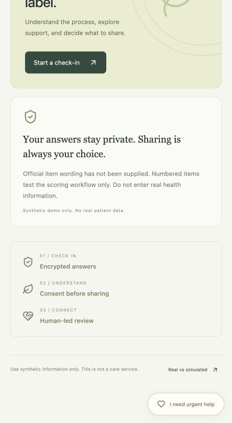

# Saha

A local, bilingual wellbeing check-in and support-navigation hackathon prototype: check-in → explanation → navigation → consented handoff → follow-up → repeated scores. Deterministic crisis signals create human-review tasks. No chatbot, LLM, passive monitoring or paid API.

**Synthetic demonstration only.** Questionnaire items are clearly marked placeholders, providers and bookings are fictional, and clinician staffing is simulated. Hotline fixtures, pathway policy and change thresholds are unverified. This is not a diagnostic or care service.

## Run

Prerequisites: Python 3.11+ and Node 20.19+ or 22.12+ with npm (tested here on Python 3.14 and Node 24). From this directory:

```sh
./run.sh
```

Open [http://127.0.0.1:8000](http://127.0.0.1:8000). One process serves the built React frontend and FastAPI backend. Startup seeds the reproducible 120-person synthetic cohort. Initial dependency installation needs internet; subsequent runtime uses no internet or external services. Keep the local server running. `PORT=8001 ./run.sh` uses another port.

The persona and reviewer selectors are deliberately open for demonstrating synthetic workflows. Never expose this server publicly or enter real health information. The launcher binds loopback only.

## Verify

```sh
./scripts/verify.sh
```

Latest recorded result: **72 pytest tests passed, 12 Node tests passed, production frontend build passed**. One upstream Starlette/httpx deprecation warning remains; no test failed. See [validation evidence](docs/VALIDATION.md) for browser coverage and explicit limits.

## Demo

Follow [the two-persona demo script](docs/DEMO_SCRIPT.md). The first persona shows moderate scoring, a fictional provider, field-level consent, successful sharing, immediate revocation, follow-up and a trend. The second demonstrates urgent guidance and simulated human review. Use the in-app **Real vs simulated** page to explain the boundary.

## Scroll-driven landing journey

The check-in welcome screen now starts with an illustrative AI-generated film and four English/Arabic chapters. The film is a metaphor, not the app interface. Both the top skip link and the final button open the existing questionnaire. No care workflow or backend logic changed.

Media paths live together in `frontend/src/heroConfig.js`. The original 4K input stays in ignored `assets-source/`; only silent 1280px (3.08 MB) and 854px (1.72 MB) all-intra copies plus two posters ship. To regenerate them with FFmpeg:

```sh
./scripts/prepare-hero-video.sh assets-source/hero-original.mp4
# Or: FFMPEG=/absolute/path/to/ffmpeg ./scripts/prepare-hero-video.sh
```

Reduced motion, short viewports and unavailable/slow media use a poster with stacked chapters. iOS Safari may defer decoding or seek unevenly, especially in power-saving modes; the mobile variant is limited to 12 seeks/second and falls back when seeking stalls or repeatedly takes too long. **Real-device iOS/Android scrolling is not verified. Arabic translations need native-speaker review.** See [hero implementation and verification](docs/HERO_JOURNEY.md) for exact sizes, test coverage and remaining limits. The repository has no configured linter; targeted Prettier formatting checks pass.

## Project layout

- `backend/app/`: FastAPI routes, SQLAlchemy models, scoring, pathway, consent, crisis and aggregate services.
- `backend/tests/`: boundaries, crisis triggers, revocation, audit immutability, privacy suppression, isolation and full-loop tests.
- `frontend/`: React/Vite, i18next English/Arabic, RTL styles and static-only PWA shell caching.
- `config/`: versioned pathway policy, user-supplied unverified hotline fixtures and placeholder instrument definitions.
- `data/generate.py`: reproducible logical synthetic records, seed 1042.
- `.runtime/`: ignored local database and encryption key. Keep them together; never commit them.

## Design and limitations

Read [architecture and privacy boundaries](docs/ARCHITECTURE.md), [source and synthetic-data assumptions](docs/ASSUMPTIONS.md), [verification register](docs/UNVERIFIED.md), and [cut scope](docs/CUT_SCOPE.md).

The attachment was an analysis DOCX, not the original `Problem_statement.pdf`. The discrepancy is documented. Published scoring arithmetic is implemented, but placeholder questions do not constitute validated PHQ-9, GAD-7 or WHO-5 assessments. A simple score-difference check is explicitly not a validated reliable-change index.

The dashboard uses only the fixed synthetic cohort, excluding the two interactive personas to keep its reference output reproducible. All charts and outcome numbers are labelled synthetic. Groups below 10 return no rows; sparse metrics and small complementary counts are also suppressed.

API routes are prefixed with `/api`. Interactive OpenAPI documentation is at `/docs` while the server runs; its CDN-based viewer may require internet, while `/openapi.json` and the app itself are local. SQLite is tested; PostgreSQL-compatible types and trigger DDL are included, but live PostgreSQL operation is not yet verified.

## Configuration

Edit `config/pathways.yaml` to adjust the versioned demonstration policy, thresholds and minimum group size (floor 10). Restart the server after backend/config changes. `DATABASE_URL` selects storage; `FIELD_ENCRYPTION_KEY` can supply a Fernet key. Missing local keys are generated with restrictive permissions. Do not change the key for an existing database.

Use `frontend/package-lock.json` and `backend/requirements-lock.txt` to reproduce the tested dependency versions. `npm --prefix frontend run format` formats the frontend. No generated build, database, token, key or original attachment is tracked in Git.


