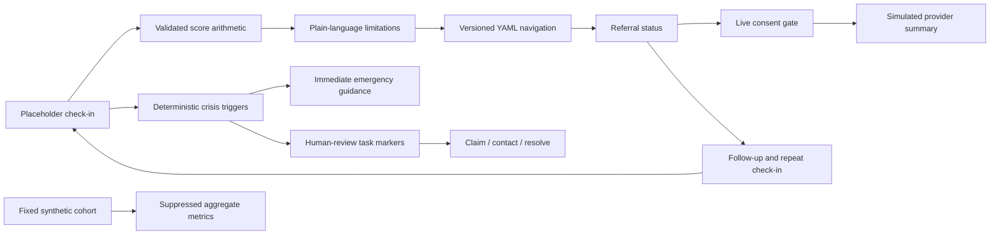

# Architecture and privacy boundaries

Saha is a single-laptop synthetic wellbeing navigation demonstration. React/Vite with i18next renders the participant and simulated reviewer UI. FastAPI serves both the compiled app and `/api` routes on loopback. SQLAlchemy stores local state in SQLite. No runtime internet connection or paid service is required after setup.

## Six requirements

| Brief requirement | Implementation | Evidence |
| --- | --- | --- |
| Early identification | `services/scoring.py`, placeholder definitions, same-instrument trends | Scoring boundaries, invalid input and trend tests; no validated item wording claim |
| Stepped support | `services/pathways.py`, five fictional providers, versioned YAML and transparent mismatch reasons | Preference and empty-match tests; browser moderate-score route |
| Crisis escalation | `services/crisis.py`, item 9 / exact phrases / urgent button, queue claim/contact/resolve | Item 9 edge cases, bilingual keyword and human-lifecycle tests; browser persona |
| Privacy and consent | Separated identities, encrypted responses, live field-scope gate, append-only audit | Owner isolation, scope, revocation, raw SQL audit mutation tests |
| Coordinated care | Provider summary with independently consented scores, context and follow-up history | Handoff and follow-up consent tests; browser revoke-and-deny |
| Outcomes and safety | Seeded cohort, fixed demographic grouping, denominator and complementary suppression, adverse-event log | Group suppression and metric pipeline tests; synthetic labels on every view |

The original challenge PDF was unavailable. This table maps the six points in the user's brief, not a claim of direct original-PDF traceability.

## Storage

Requested tables: `users`, `assessments`, `consents`, `referrals`, `providers`, `escalations`, `followups`, `pathway_rules`, `audit_log`. Additional `identities` separates demo credentials from responses; `adverse_events` stores safety events. No name, email, phone number or contact identity is collected.

Fernet authenticates and encrypts assessment answer arrays and free text, physical-health context, follow-up notes, resolution notes and adverse-event notes. Scores, bands, pseudonymous foreign keys and operational timestamps remain queryable. This is field encryption, not complete database encryption. The local key is in ignored `.runtime/field.key` with mode 0600, inside a 0700 directory; `FIELD_ENCRYPTION_KEY` can override it. Never lose or replace the key for an existing database. A database administrator or a process with key access is outside this demo's trust boundary.

UTC-aware SQLAlchemy timestamp conversion prevents SQLite's naive datetime representation from changing displayed time intervals. PostgreSQL-compatible field types and audit-trigger DDL are included, but a live PostgreSQL run has not been performed.

## Authentication and consent

`POST /api/demo/session` deliberately allows selecting a synthetic participant, provider or reviewer. The banner and documentation explicitly describe this as an open local demo. Tokens are random, only hashes are stored, and frontend tokens stay in memory. This provides role isolation for exercising API checks; it is NOT production authentication. Anyone who can reach the local demo can choose a simulated role. The launcher binds only `127.0.0.1`; never expose it publicly or put real information into it.

`services/consent.py::require_consent` is the single gate for third-party reads. It queries current, unrevoked consents on every call. A provider must match the referral's provider ID and possess the requested `care_handoff` field scopes. Scores, context and follow-up history can be independently granted and requested. Nothing is preselected in the grant form. A read requesting any missing scope fails as a whole. Multiple active grants combine; revoke all grants for a field to remove access. Denials and successful reads are audited.

Operational reviewer views also pass through this gate, checking the current ledger, with an explicit `operational=True` mode and an empty patient-field scope. The gate returns **false for patient-content permission**. The route exposes only a whitelisted task ID, lifecycle times/status, or adverse-event category/time; never user ID, response, score, trigger text, context, note or contact details. This lets the demo create and claim a task without fabricating consent. It is not an emergency override to view patient records and cannot enable real outreach. A production emergency-access policy and accountable staffing remain unverified.

Revocation blocks subsequent reads immediately; permissions and summaries are not cached. It cannot retract material already seen by a recipient or cancel a response already authorised in flight. No real third-party transmission occurs in this app.

Audit rows have database triggers rejecting UPDATE and DELETE, including raw SQL. The ledger records actor role/grantee, action, resource and scope without copying health text into logs. Database-owner tampering, dropping triggers or deleting the database are not prevented; no cryptographic tamper-proof claim is made.

## Safety behaviour

Backend rules always evaluate accepted participant submissions. The frontend also matches the server-supplied exact keyword list while typing, immediately surfaces and focuses guidance, and posts a review signal. PHQ-9 item 9 >0 signals immediately even before completing the form. Each submitted signal may create a separate task; no automatic merging or closure hides a repeat signal. A failed save leaves visible guidance and an explicit failure message. There is no inferred diagnosis, sentiment model or LLM.

Claiming is an atomic conditional state update. Resolution requires the task to be claimed by the same simulated reviewer, a recorded simulated contact and an explicit note. Timers are labelled demo targets. The hardcoded `human_online=false` is honest: there is no actual staffed service. Unverified hotline fixtures are displayed with warnings, not call actions.

## Metrics

Only the fixed `cohort=true, synthetic=true` population contributes. Interactive personas are excluded and the UI says so. Each person contributes once to each measure. Handoff percentages use distinct referred people; accepted/booked/attended are cumulative timestamps. First-follow-up time is the earliest interval from referral creation to recorded follow-up. Score change is last minus first within each instrument. Crisis completion requires all of that person's tasks to be resolved. Human-contact time uses the first recorded interval. Missing data returns null, never an invented zero.

Group size and metric-contributor minimum default to 10; configuration may raise the floor. Rates additionally suppress positive or complementary counts from 1–9. Adverse-event participant counts use complementary suppression. Groups under the minimum return no row. The API accepts only one of the six named dimensions and no arbitrary filters. These controls are not a formal differential-privacy guarantee.

## Offline and operations

The service worker caches only build assets, icon, manifest and app shell. It does not intercept `/api`. API responses use `Cache-Control: no-store`. If the internet is disconnected but the local server continues, the complete demo works. If the server stops, only cached UI and static emergency guidance remain; authenticated actions fail visibly and are never queued for later replay. Initial dependency setup requires internet or preinstalled/cached dependencies.

Rules and config are loaded at server startup; restart after changing them. No external telemetry, remote fonts, analytics, paid API, provider call or notification service is configured. Source documentation lists what remains to verify before any non-synthetic use.
